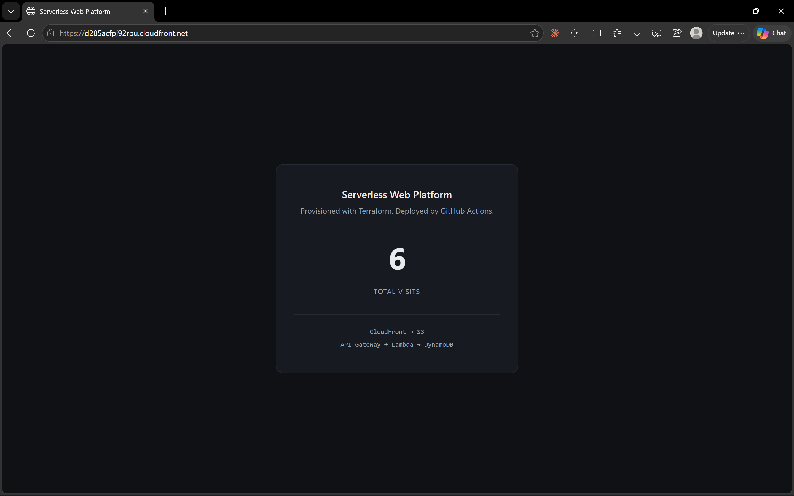
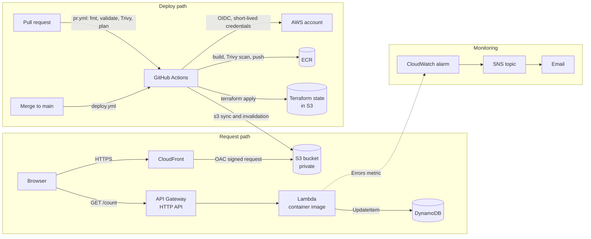
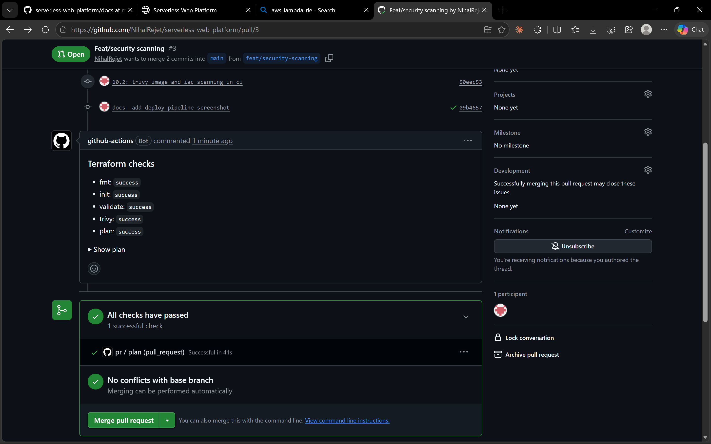
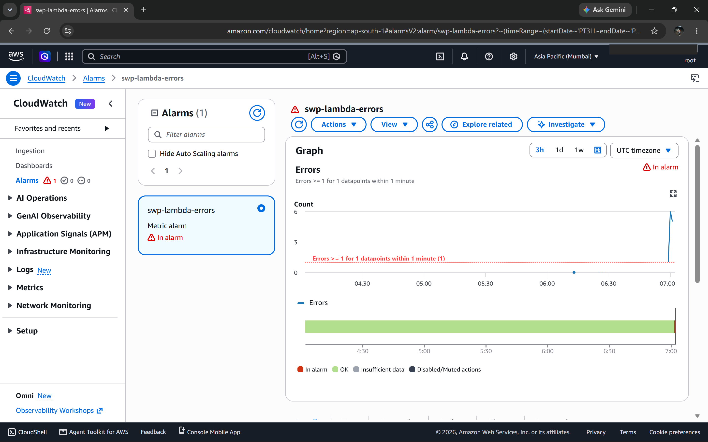
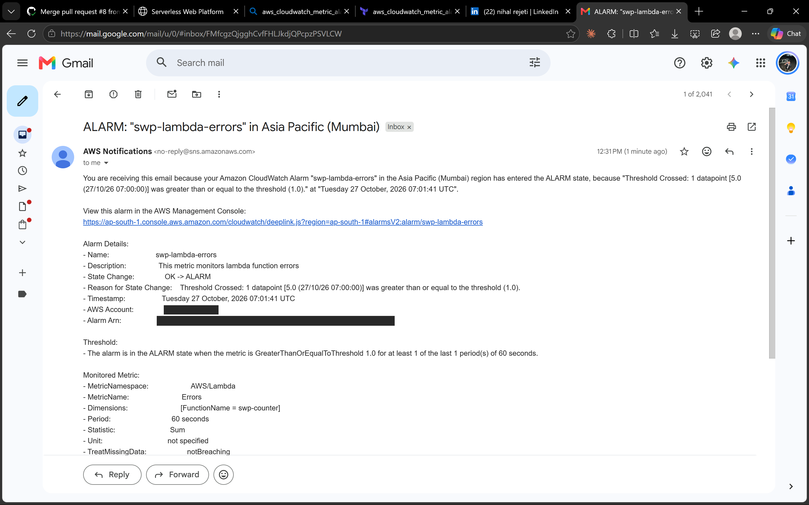
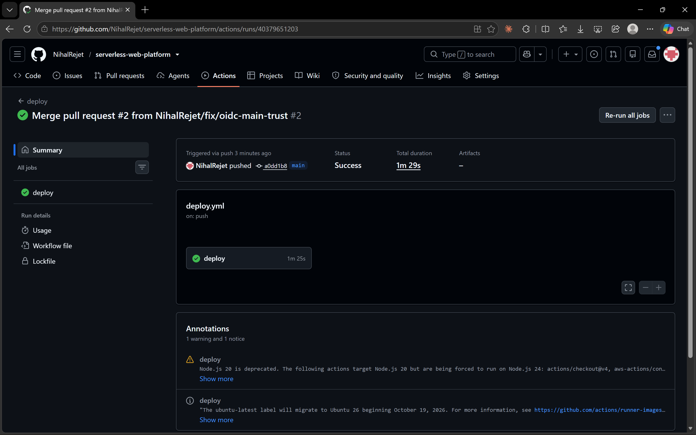

# Serverless Web Platform on AWS

[](https://github.com/NihalRejet/serverless-web-platform/actions/workflows/deploy.yml)

A static website with a live visitor counter, built on serverless AWS services. All of it is defined in Terraform and deployed by a GitHub Actions pipeline with no stored AWS keys.

**Live site:** https://d285acfpj92rpu.cloudfront.net
*(The account runs on the AWS Free Plan, so the live site may go offline when the plan period ends. The screenshots below show it working.)*



---

## What it does

- **Static site:** HTML and JavaScript served by CloudFront from a private S3 bucket.
- **Visitor counter:** the page calls an HTTP API. A Lambda function (a Docker image) adds 1 to a counter in DynamoDB and returns the new value.
- **Infrastructure as code:** every AWS resource is in Terraform, with remote state in S3.
- **CI/CD:** a pull request runs checks and posts the Terraform plan as a comment. A merge to `main` builds, scans and deploys everything.
- **Security scanning:** Trivy scans the container image before it is pushed, and scans the Terraform on every pull request.
- **Monitoring and cost:** a CloudWatch alarm emails me when the Lambda fails, and a monthly budget emails me before costs pass $5.

---

## Architecture



**How a visit works:**
1. The browser loads `index.html` and `app.js` from CloudFront. The bucket is private, so only this CloudFront distribution can read it.
2. `app.js` calls `GET /count` on API Gateway.
3. API Gateway invokes the Lambda. It increases the counter in DynamoDB with one atomic update and returns `{"count": N}`.

---

## Screenshots

**Pull request gate.** Every PR runs `fmt`, `validate`, a Trivy scan and `plan`, then posts the results as a comment. Nothing reaches AWS without a reviewed plan.



**Alarm tested on purpose.** I deployed a broken Lambda, sent requests to it, and watched the alarm fire and the email arrive. Then I reverted the change through a PR.





**Deploy on merge.** A merge to `main` deploys in about 90 seconds with no manual steps.



---

## Tech stack

| Area | Tool | What it does here |
|---|---|---|
| CDN | CloudFront | HTTPS, caching, compression, security headers, access logs |
| Static hosting | S3 | Private bucket, read only through Origin Access Control |
| API | API Gateway (HTTP API) | One route, `GET /count`, with CORS |
| Compute | Lambda (Python 3.12, container image) | Increases and returns the counter |
| Database | DynamoDB (on-demand) | Stores the counter; point-in-time recovery on |
| Images | ECR | Immutable tags, scan on push, keeps the last 5 images |
| IaC | Terraform 1.16, AWS provider 5.x | All resources; state in S3 with native locking |
| CI/CD | GitHub Actions | `pr.yml` (review) and `deploy.yml` (deploy) |
| Auth for CI | GitHub OIDC + IAM role | Short-lived credentials, no stored keys |
| Security scanning | Trivy | Image scan before push; Terraform scan on PRs |
| Monitoring | CloudWatch + SNS | Lambda error alarm, email alerts, 14-day log retention |
| Cost control | AWS Budgets | $5 monthly budget, email at 80% |

---

## CI/CD pipeline

**`pr.yml` runs on every pull request to `main`:**

1. `terraform fmt -check`
2. `terraform init` and `terraform validate`
3. Trivy scan of `infra/` (fails on HIGH or CRITICAL)
4. `terraform plan` (read-only, `-lock=false`)
5. Posts all results and the plan as a PR comment
6. Fails the job at the end if any check failed

Every check runs even when an earlier one fails, so the comment always shows the full picture.

**`deploy.yml` runs on every push to `main`:**

1. Assumes the AWS role through OIDC
2. Builds the Docker image, tagged with the commit SHA
3. **Scans the image with Trivy before pushing.** A vulnerable image never reaches ECR.
4. Pushes the image to ECR
5. `terraform apply` with `image_tag` set to the commit SHA, so the Lambda runs the image built from this commit
6. Syncs `frontend/` to S3 and clears the CloudFront cache

Each deploy maps to exactly one commit. To roll back, I revert the PR, and the pipeline deploys the previous code again.

---

## Security

- **Private S3 bucket.** Public access is blocked. The bucket policy allows only `s3:GetObject`, and only for this CloudFront distribution (checked with `AWS:SourceArn`).
- **No AWS keys in GitHub.** The pipeline gets temporary credentials through OIDC. The only secret, `AWS_ROLE_ARN`, is an identifier, not a credential.
- **Tight OIDC trust policy.** The role can only be assumed by this repository, and only from pull requests or the `main` branch (exact `StringEquals` match, no wildcards).
- **Least privilege for the Lambda.** It may only call `dynamodb:UpdateItem` on its own table, plus write its own logs.
- **API Gateway permission is scoped** to this API's ARN, so no other API can invoke the function.
- **Encryption.** Terraform state is encrypted in S3. The site and log buckets use SSE-S3, and DynamoDB is encrypted at rest by default.
- **Security headers** on every response: HSTS, `X-Content-Type-Options: nosniff`, `X-Frame-Options: DENY` and a strict referrer policy.
- **Immutable image tags.** A pushed tag can never be overwritten.
- **Scanning in CI.** Trivy checks the image and the Terraform. I either fixed each finding or wrote down why I accepted it (see below).

### Accepted scanner findings

Each accepted finding has a comment next to it in the code explaining why.

| Finding | Why I accepted it |
|---|---|
| CloudFront has no WAF (AWS-0011) | A WAF is billed monthly and is outside the free tier. The bucket is private and the site is static. |
| S3 buckets don't use a customer-managed KMS key (AWS-0132) | A customer-managed key costs money; the data is already encrypted with SSE-S3. For the log bucket, SSE-KMS isn't supported for log delivery. |
| SNS topic isn't encrypted (AWS-0095) | CloudWatch alarms can't publish to a topic encrypted with the default AWS-managed key, so encrypting it with that key would silently break alerts. A customer-managed key costs money, and the messages hold no sensitive data. |
| CVE in `aws-lambda-rie` (in `.trivyignore`) | The Runtime Interface Emulator is AWS's local-testing tool in the base image. It isn't run by the Lambda service, and a package upgrade can't patch it. |

---

## Problems I found and how I fixed them

These are the parts I learned the most from.

**1. The pipeline was green, but it never deployed new code.**
The Lambda's `image_uri` was hard-coded to the first `bootstrap` tag. Every deploy built and pushed a new image, then Terraform saw nothing to change. I found it during the alarm test, because a deliberately broken version kept returning `200`. I checked which image the Lambda was running with `aws lambda get-function`, and changed `image_uri` to use the `image_tag` variable.

**2. The alarm could never fire.**
The handler caught every exception and returned a clean `500`. To the Lambda service, that is a successful run, so the `Errors` metric stayed at zero. I changed the handler to log the error and re-raise it.

**3. The OIDC role refused GitHub.**
GitHub changed its OIDC subject format for repositories created after July 2026: it now includes numeric owner and repository IDs. My trust policy used the old format. I printed the token's `sub` claim in a temporary workflow step and updated the policy. A later failure on `main` showed I had allowed only pull requests, so the policy now lists the two exact subjects, with no wildcard.

**4. `dnf update` patched nothing.**
Trivy reported 43 HIGH findings in the base image's system packages, all with fixes available. Amazon Linux 2023 locks packages to the image's release version, so a plain update said "nothing to do". Using `dnf upgrade --releasever=latest` brought the OS findings to zero.

**5. The budget would have stayed silent.**
I copied a Terraform example that filtered the budget to EC2 only. This project has no EC2, so the budget could never reach its limit. I removed the filter so it covers all services.

**6. Logs kept forever.**
Lambda creates its log group automatically, with no expiry. I brought it under Terraform with an `import` block and set retention to 14 days.

---

## Key decisions

- **Serverless instead of a server.** Lambda, DynamoDB and API Gateway cost nothing when idle and need no patching or scaling work.
- **Lambda as a container image.** It shows the full Docker workflow (build, scan, push to a registry) instead of a zip upload.
- **Separate review and deploy workflows.** `pr.yml` can only read and plan; `deploy.yml` changes AWS. A change reaches AWS only after a reviewed plan.
- **Scan before push.** Scanning after the push would leave a vulnerable image in the registry where Lambda could use it.
- **Commit SHA as the image tag.** Every running version maps to one commit, and with immutable tags a version can't be replaced silently.
- **S3 native state locking** (`use_lockfile`) instead of a separate DynamoDB lock table. It is one less resource to create and manage.
- **Origin Access Control** instead of the older Origin Access Identity, because OAC is AWS's current recommendation and signs requests with SigV4.

---

## Repository layout

```
.
├── app/                  Lambda code and Dockerfile
├── frontend/             index.html and app.js
├── infra/                Terraform (one file per area)
│   ├── s3_cloudfront.tf  site bucket, log bucket, CloudFront, bucket policy
│   ├── apigateway.tf     HTTP API, route, Lambda permission
│   ├── lambda.tf         Lambda function and its IAM role
│   ├── lambda_ecr.tf     ECR repository and lifecycle policy
│   ├── dynamodb.tf       counter table
│   ├── iam_github_oidc.tf  OIDC provider and GitHub Actions role
│   ├── monitoring.tf     SNS topic, alarm, log group
│   ├── budget.tf         monthly budget
│   └── backend.tf, providers.tf, variables.tf, outputs.tf
├── .github/workflows/    pr.yml and deploy.yml
└── docs/                 screenshots
```

---

## Setting it up from scratch

Prerequisites: an AWS account, the AWS CLI, Terraform 1.11 or newer, and Docker.

There are two one-time "chicken-and-egg" steps, because Terraform needs some things to exist before it can manage the rest.

**1. Create the state bucket by hand.** Terraform stores its state in S3, so that bucket must exist before `terraform init`. Pick a unique name and set it in `infra/backend.tf`:

```bash
aws s3api create-bucket --bucket <your-state-bucket> --region ap-south-1 \
  --create-bucket-configuration LocationConstraint=ap-south-1
aws s3api put-bucket-versioning --bucket <your-state-bucket> \
  --versioning-configuration Status=Enabled
```

**2. Push a first image before creating the Lambda.** A Lambda that uses a container image can't be created until an image exists in ECR:

```bash
cd infra
terraform init
terraform apply -target=aws_ecr_repository.swp_counter_ecr

REPO=$(terraform output -raw ecr_repository_url)
aws ecr get-login-password --region ap-south-1 | docker login --username AWS --password-stdin ${REPO%%/*}
docker build --provenance=false -t $REPO:bootstrap ../app
docker push $REPO:bootstrap

terraform apply
```

**3. Connect GitHub.** Set the `sub` values in `infra/iam_github_oidc.tf` for your own repository (read them from a workflow run, since new repositories use the ID-based format). Then add the role ARN as a repository secret named `AWS_ROLE_ARN`:

```bash
terraform output -raw github_role_arn
```

Also change `alert_email` in `infra/variables.tf` to your own address, and confirm the SNS subscription email that AWS sends you.

From then on, every change goes through a pull request, and the pipeline does all deploys. Don't run `terraform apply` locally after this: the `image_tag` variable defaults to `bootstrap`, so a local apply would point the Lambda back at the first image.

---

## Cost

As of late October 2026, the bill for the month is **$0.00**. Everything runs inside AWS free tier limits:

| Service | Free tier | Usage this month |
|---|---|---|
| CloudFront | 10M requests and 1,000 invalidation paths per month | about 100 requests, 3 invalidations |
| Lambda | 1M requests per month | well under 1% of the limit |
| DynamoDB | 25 GB storage, on-demand requests cost fractions of a cent | one item |
| S3 | a few MB of static files | |
| ECR | 500 MB storage | last 5 images kept by the lifecycle policy |

A $5 monthly budget emails me at 80% of actual spend, as a safety net.

---

## Known limitations and what I'd do next

- **The GitHub Actions role has `AdministratorAccess`.** Next step: narrow it to the exact actions the pipeline uses.
- **I use the root user in the console.** Next step: an IAM Identity Center user for daily work, and MFA-only root.
- **One region and one environment.** Next step: separate `dev` and `prod` with Terraform workspaces or separate state files.
- **No custom domain.** The site uses the default `*.cloudfront.net` certificate, so the minimum TLS version can't be raised. Next step: Route 53 and an ACM certificate.
- **The API has no rate limiting.** Next step: throttling on the API Gateway stage.
- **No API access logs or Lambda tracing.** Next step: API Gateway access logs and X-Ray.
- **No WAF or customer-managed KMS keys,** for cost reasons (see accepted findings).
- **The API URL is hard-coded in `app.js`.** Next step: inject it at deploy time from `terraform output`.
- **No automated tests for the Lambda.** Next step: unit tests with a mocked DynamoDB, run in `pr.yml`.

---

## Author

**Nihal Rejeti** · [GitHub](https://github.com/NihalRejet)
